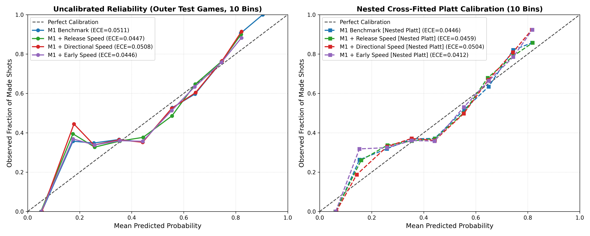

# CourtIQ: Pressure-Aware Shot Quality and Kinematic Evaluation

[](https://www.python.org/downloads/)
[](LICENSE)
[]()
[-orange.svg)]()

> **Audited Sports Analytics Benchmark for Live Basketball Tracking Data**  
> *Release-time shot outcome prediction using spatial context, defensive pressure, and player kinematics across 1,322 live-play field goals from Spanish Liga ACB (2025–26 season).*

---

## 1. Project Overview & Research Scope

CourtIQ investigates whether adding high-resolution defensive contest context and pre-release shooter movement improves probabilistic field-goal outcome prediction on held-out games.

### Frozen Primary Research Question
> *"Does adding shooter movement information improve held-out-game prediction of basketball field-goal outcomes beyond a baseline using shot characteristics and defensive context measured at shot release?"*

### Frozen Benchmark Features (M1)
The frozen M1 benchmark uses **12 raw input variables**:
- **Continuous (5):** `distance` (shooter to hoop in ft), `shotClock` (seconds remaining), `releaseTime` (possession elapsed seconds), `dribblesBefore` (dribble count), `closestDefDist` (distance to nearest defender in ft).
- **Categorical (7):** `shotType` (floater, heave, jumper, layup, post), `three` (boolean), `catchAndShoot` (boolean/None), `createdFromPaint` (boolean), `period` (1–4, OT), `contestLevel` (open, light, average, plus, blocked), `contested` (boolean indicator, defender within 5.0 ft).

### Epistemological Boundaries
- **Prediction Timestamp:** Evaluated strictly at shot release (`startFrame`).
- **Release-Time Outcome Prediction:** Models conditional probability of shot conversion ($P(\text{Made} = 1 \mid X_t)$).
- **Not a Decision Model:** This system does **not** evaluate counterfactual decision quality (i.e. whether a player should have passed, driven, or shot).
- **No Causal Claims:** Associations reflect observational conditional likelihood under defensive contest, not causal treatment effects.

---

## 2. Portfolio Summary (Data Science & Analytics Engineering)

This repository serves as a showcase of **audit-driven, leakage-safe machine learning engineering** and rigorous statistical validation on real-world spatiotemporal sports tracking data:
- **Leakage-Safe Nested Cross-Validation:** Implemented a 10-outer $\times$ 9-inner Leave-One-Game-Out (LOGO) cross-validation pipeline with in-fold Platt scaling, eliminating resubstitution calibration bias.
- **Cluster-Aware Uncertainty Quantification:** Conducted paired game-cluster bootstrap resampling ($B = 2,000$ iterations) to prevent pseudo-replication on grouped match data.
- **Biomechanical & Spatiotemporal Feature Engineering:** Extracted high-precision 25 Hz kinematic indicators (release lookback speed, approach momentum, rim-relative radial/tangential velocity vectors) under strict anti-leakage guards.
- **Scientific Honesty & Benchmark Governance:** Resisted false-positive claims by retaining the M1 release-context baseline as the official frozen benchmark when kinematic improvements fell within sampling uncertainty.

---

## 3. Architecture & Validation Pipeline

```
                                  [ SkillCorner 25 Hz Tracking & Dynamic Events ]
                                                         │
                                                         ▼
                                          [ Shot Cleaning & FIBA Filtering ]
                                     • 1,459 Raw Events Ingested
                                     • 26 Unlocated & 111 Fouled Misses Excluded
                                     • 1,322 Valid Attempts Across 10 Games
                                                         │
                                                         ▼
                                        [ Outer Leave-One-Game-Out CV (x10) ]
                                ┌────────────────────────┴────────────────────────┐
                                │ Outer Training (9 Games)                         │ Outer Test (1 Game)
                                │ (N ≈ 1,190 shots)                               │ (N ≈ 130 shots)
                                ▼                                                 │
            [ Inner LOGO Cross-Validation (x9) ]                                  │
    ┌───────────────────────────┴───────────────────────────┐                     │
    │ Inner Train (8 Games)       │ Inner Val (1 Game)      │                     │
    │ Fit Pipeline Transformers   │ Predict Probabilities   │                     │
    └─────────────────────────────┴─────────────────────────┘                     │
                                │                                                 │
                                ▼                                                 │
                  [ Cross-Fitted Inner Predictions ]                              │
                                │                                                 │
                                ▼                                                 │
                   [ Fit Platt Calibrator ]                                       │
            ln(P_cal / (1-P_cal)) = a * logit(P_raw) + b                          │
                                │                                                 │
                                ▼                                                 │
                   [ Fit Outer Base Pipeline ]                                    │
                                │                                                 │
                                └───────────────────────┬─────────────────────────┘
                                                        ▼
                                         [ Predict Untouched Outer Test ]
                                          1. Raw Probabilities (Primary)
                                          2. Nested Calibrated Probabilities
                                                        │
                                                        ▼
                                  [ Paired Game-Cluster Bootstrap (B=2,000) ]
```

---

## 4. Benchmark Performance & Key Findings

All models evaluated on matched **1,322 eligible shot attempts** across **10 outer game folds**:

| Model Specification | Raw Features | Design Columns ($d$)* | Outer Log Loss | $\Delta$ Log Loss vs M1 | 95% Cluster Bootstrap CI | Brier Score | ROC-AUC | 10-bin ECE | Win Rate (vs M1) | Status |
| :--- | :---: | :---: | :---: | :---: | :---: | :---: | :---: | :---: | :---: | :---: |
| **M0 Baseline (Spatial/Mechanics)** | 9 | 21 | 0.655161 | +0.037891 | — | 0.231456 | 0.641026 | 0.030552 | — | Deprecated |
| **M1 Benchmark (Frozen)** | 12 | 29 | **0.617270** | — | — | **0.215942** | **0.694100** | 0.051075 | — | **Official Benchmark** |
| **M1 + Speed Rel ($[t-0.4\text{s}, t]$)** | 13 | 30 | **0.616512** | **-0.000758** | **[-0.002177, +0.000854]** | **0.215511** | **0.696695** | **0.044691** | **7 / 10 Games** | **Exploratory Hypothesis** |
| **M1 + Speed Early ($[t-0.8\text{s}, t-0.4\text{s}]$)**| 13 | 30 | 0.617179 | -0.000091 | [-0.001136, +0.000901] | 0.215850 | 0.694897 | 0.044617 | 5 / 10 Games | Signal Decayed |
| **M1 + Directional ($v_{\text{rad}} + v_{\text{tan}}$)** | 14 | 31 | 0.618350 | +0.001080 | [+0.000211, +0.002238] | 0.216403 | 0.692545 | 0.050836 | 1 / 10 Games | **Statistically Worse** |

*\*Design column counts reflect the 9 training folds containing regulation and overtime periods. In Fold 6 (held-out game `178442`), the training fold contains no overtime shots (`period == 5`), yielding $d - 1$ design columns (e.g., $d=28$ for M1; $d=29$ fitted parameters including intercept).*

### Calibration Audit & Visual Diagnostics
Nested cross-fitted Platt calibration consistently shrinks probabilities toward the prior ($a = 0.9110 \pm 0.0067$), improving M1 outer log loss ($-0.000144$) and reducing 10-bin Expected Calibration Error by 12.7% ($0.0511 \to 0.0446$).



---

## 5. Three Distinct Validation Standards

| Validation Standard | Assessment | Evidence & Technical Justification |
| :--- | :---: | :--- |
| **1. Code Reproducibility** | **VERIFIED (GO)** | Clean setup; exact deterministic metric reproduction across 49 passing automated tests. |
| **2. Evaluation Defensibility** | **DEFENSIBLE (GO)** | Zero test leakage; nested cross-fitted Platt calibration; cluster-aware bootstrap inference. |
| **3. External Validation** | **UNVERIFIED (NO-GO)** | Evaluated strictly on 10 Liga ACB games; external generalization to NBA/EuroLeague unproven. |

---

## 6. Setup & Execution Instructions

### Environment Prerequisites
- Python 3.10 to 3.12 (Validated on Python 3.10.11, 64-bit Windows / Linux).
- Git.

### 1. Clone & Set Up Virtual Environment
```powershell
git clone <repo-url> courtiq
cd courtiq

# Create and activate virtual environment
python -m venv .venv
.\.venv\Scripts\Activate.ps1   # Windows PowerShell
# source .venv/bin/activate    # Linux / macOS
```

### 2. Install Pinned Dependencies
```powershell
python -m pip install --upgrade pip
pip install -r requirements.txt
pip install -e .
```

### 3. Run Automated Test Suite
```powershell
pytest -v
```
*(49 unit and integration tests validate schema parsing, alignment, anti-leakage, directional mathematics, and nested calibration).*

### 4. Reproduce Phase 3A/3B Evaluation Pipeline
```powershell
python scripts/run_phase3a.py
```
Outputs generated in `reports/phase3a/`:
- `phase3a_oof_predictions.csv`: 1,322 matched out-of-fold predictions.
- `phase3a_metrics.json`: Complete machine-readable pooled, per-game, bootstrap, and sensitivity metrics.
- `calibration_reliability.png`: High-resolution 10-bin calibration curves.

---

## 7. Limitations & Threats to Validity

1. **Small Cluster Count ($K = 10$ Games):** Although 1,322 shots provide ample sample size, they originate from only 10 distinct matches. Cluster bootstrap confidence intervals reflect substantial between-game variance.
2. **Observational Shot Prediction vs. Decision Quality:** Expected conversion rates conditional on a shot release cannot evaluate whether an alternative passing or driving decision was tactically superior.
3. **No Player Skill Random Effects:** Models purposely omit player identity intercepts to prevent overfitting on small samples, treating shots as generic attempts under defensive context.
4. **Sensor Extrapolation Impact:** Approximately 8.7% ($N=115$) of tracking frames utilize optical extrapolation during occlusion, which magnifies velocity signals.

---

## 8. Data Licensing & Attribution

- **Tracking Data Source:** SkillCorner Open Data — Basketball ([GitHub Repository](https://github.com/SkillCorner/opendata-basketball)).
- **Upstream License:** MIT License (Copyright (c) 2026 SkillCorner).
- **Data Governance Policy:** Raw match payloads are excluded from Git repository tracking under competition guidelines.
- **Attribution Notice:**
  > *"Optical tracking and dynamic event data provided courtesy of SkillCorner (Spanish Liga ACB 2025–2026 season sample)."*
